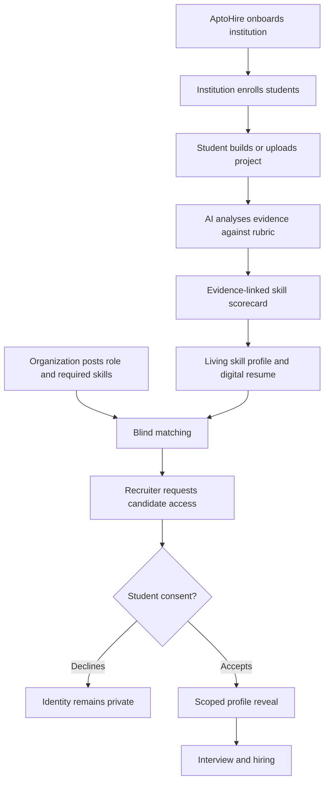

# AptoHire — MVP & Story

> **Let skills speak through proof — before identity speaks for the student.**

AptoHire is a proof-of-work talent ecosystem connecting **institutions, students and organizations**. Students demonstrate skills through real projects; AI helps assess the submitted evidence; their verified work builds a living digital profile; and recruiters discover relevant talent through blind matching, with identity revealed only after student consent.

<strong>At a glance — what makes AptoHire different?</strong>

- **Proof, not just claims:** project submissions, demos, code and supporting evidence.
- **AI-assisted skill verification:** skill-wise scorecards with evidence references and review routes.
- **Living digital resume:** one evolving profile built from projects, skills and student-authorized sources.
- **Blind talent discovery:** recruiters match on skills before seeing identity.
- **Consent-led hiring:** students decide whether to reveal their identity and approved profile details.
- **Institution intelligence:** private student/alumni management, placement visibility and skill-gap insights.

## 1. The problem and the idea

Traditional resumes mostly describe what a candidate *says* they can do. They do not consistently prove what the candidate has built or how well they performed. Skilled students can be overlooked because of limited networks or institutional brand, while recruiters spend time screening and manually checking claims. Institutions also need a clearer view of practical skills, placement activity and alumni outcomes.

**AptoHire turns work into evidence.** It is not simply another job portal or portfolio builder. It connects a student's work to assessed skills, keeps the evidence in a living profile, and helps employers discover talent without identity-first screening.

## 2. The three-sided ecosystem

<strong>🏛️ Institution — trusted entry point</strong>

The AptoHire team reaches out to universities/colleges. After verification and onboarding, an institution gets its own workspace and enrolls its students.

- Manage only its own students, departments and alumni.
- Track project progress, skill development and permitted placement data.
- View organization job postings and share relevant opportunities with students.
- Understand aggregated skill demand and gaps to inform training/curriculum.
- Maintain student lifecycle status (current student, alumni, dropout) without erasing earned skill evidence.

One institution cannot access another institution's private student records. Improved placement evidence may support institutional reputation; AptoHire does not guarantee a ranking increase.

<strong>🎓 Student — build, prove and grow</strong>

Students join through their institution or an enabled individual route. They can request a guided project or upload work completed elsewhere.

1. Build a project based on their interests and target skills.
2. Submit a project description, demo video, audio explanation, documents, GitHub/source-code link or live project.
3. Receive an AI-assisted, project-specific skill scorecard.
4. See evidence, strengths, improvement areas and assessment limitations.
5. Raise a ticket if they disagree with a score; AptoHire reviews the case.
6. Add previously acquired skills, certificates and external work.
7. Generate a downloadable digital resume from the evolving skill profile.
8. Connect LinkedIn/GitHub only with permission. Integrations may suggest profile updates; the student should control what is accepted into their AptoHire profile/resume.

The student's proof-of-work record should continue after graduation or an institution change. An unverified institution label must not erase independently demonstrated skills.

<strong>🏢 Organization — discover through proof</strong>

AptoHire reaches out to startups and companies. An approved organization posts a role and defines the required skills.

- AI compares job requirements with anonymized skill profiles.
- Recruiters see limited candidate summaries and relevant proof—not unrestricted student identities.
- Recruiters can send an access/interview request.
- Only after the student accepts does the organization receive the identity and specific profile fields covered by consent.
- The recruiter can then proceed with interview and hiring.

## 3. The AptoHire story — one student, one opportunity

**First, AptoHire reaches an institution.** Institution A is verified and onboarded. It enrolls its students and receives a private dashboard. Institution B has a separate workspace and cannot inspect Institution A's student records.

**Meet Aman.** Aman joins through Institution A. He wants to demonstrate frontend development. He asks for a practical project or uploads a project he has already built. He submits a demo video, explanation, repository and live link.

**AI turns the submission into a skill record.** The multimodal proof audit workflow analyses the available evidence against a project-specific rubric. It may assess implementation, problem solving, code quality and communication—but each criterion must use appropriate evidence. A coding project should not be scored like a public-speaking contest. Aman sees the scorecard and can raise a review ticket if something is inaccurate.

**His profile becomes a living digital resume.** Aman adds skills and work from outside AptoHire. With permission, connected professional sources can suggest updates. His downloadable resume connects skill claims to project evidence instead of relying only on self-reported statements.

**A recruiter posts a role.** The blind matching agent compares the role's required skills with anonymized profiles. The recruiter sees relevant skill-fit summaries and requests access to Aman.

**Aman decides.** He can accept or decline. If he accepts, only the approved identity/profile information is revealed. The recruiter can invite him to interview.

> **The magic moment:** the recruiter discovers what Aman can do before being influenced by who Aman is. Aman chooses when to be known.

## 4. The MVP — prove one complete loop

The MVP should prove a single credible journey, not promise every future feature.

| Portal | MVP must-have | What it proves |
|---|---|---|
| AptoHire Admin | Verify institutions/organizations; onboarding; support/dispute handling; audit visibility | Trust and operational control |
| Institution | Onboarding; student enrollment; own-student dashboard; job-post visibility; placement/alumni and skill-gap views | A private institutional talent pipeline |
| Student | Profile; project discovery/submission; AI scorecard; dispute ticket; skills/evidence profile; digital resume; consent inbox | Students can prove and control their skills |
| Organization | Verification; job post and skill criteria; anonymized matches; access request; consent-gated reveal | Recruiters can discover talent without unrestricted identity access |

### Core MVP journey

### Defer until the loop works reliably

- Large multi-university rollout and broad LMS/ATS integrations.
- Fully automatic external profile publishing.
- High-stakes automated hiring decisions.
- Complex career prediction features.
- Paid student tiers before willingness-to-pay is tested.

## 5. AI layer — specialised agents

| Agent / service | Job |
|---|---|
| Skill-based Project Agent | Suggest projects based on interests, current skills and target level |
| Evidence/OCR/Vision Agent | Extract observations from submitted files, screenshots, documents and visual evidence |
| Multimodal Proof Audit Engine | Analyse audio/video/explanation and project artifacts against a skill rubric |
| Scorecard & Skill Graph | Consolidate evidence-backed skills and preserve assessment history |
| Predictive Blind Matching Agent | Compare job requirements with anonymized skill profiles |
| Profile Manager | Suggest updates from student-approved profile data and authorized integrations |
| Consent & Access Service | Enforce request, decision, scope, expiry/withdrawal and audit trail |
| Alumni/Career Progression Agent | Maintain lifecycle continuity and suggest next skills |

**Assessment rules:** evidence before score; rubric before model; project-aware criteria; confidence/limitations visible; human review for disputes; no false claims of external credential verification; no irrelevant sensitive attributes in matching; auditable model/rubric/evidence provenance.

A scorecard should show the skill, score scale, rubric criteria, evidence references, strengths, improvement areas, confidence/evidence sufficiency and review status. A single aggregate score must not hide skill-level performance. The proposed `50+` verification threshold in the concept notes should be calibrated per skill—not treated as a universal standard.

## 6. Privacy and trust

| Who | Access boundary |
|---|---|
| Student | Own profile, evidence, scorecards and consent requests |
| Institution | Its own students and permitted aggregate/placement/alumni data |
| Organization | Job posts and anonymized candidate summaries first; approved details after consent |
| AptoHire operations | Minimum access needed for verification, support and dispute handling, with audit |

**Consent sequence:** job requirements → anonymized matching → limited candidate summary → access request → student decision → scoped reveal → expiry/withdrawal and audit.

A decline must not penalize the student. Consent should state who requests access, which fields, why, and for how long. Enforce tenant isolation and server-side authorization; keep secrets out of frontend code; use private storage and time-limited file access; minimize retention; align privacy operations with applicable Indian data-protection requirements.

## 7. Business model and go-to-market

| Paying side | Revenue hypothesis | Value |
|---|---|---|
| Institutions | Annual/semester licence; enterprise tier | TPO dashboard, verification, placement/alumni analytics, skill-gap insights |
| Organizations | Recruiter SaaS subscription; optional pay-per-hire/success fee | Proof-led discovery, blind matching and lower screening effort |
| Students | Free core; optional premium later | Skill profile, proof-of-work, digital resume and opportunity discovery |

**Go-to-market:** (1) AptoHire approaches institutions → (2) institution enrolls students → (3) students build proof-backed profiles → (4) AptoHire reaches recruiters → (5) recruiters post skills/jobs and use blind matching → (6) consented interviews and placements create value for all sides.

An institution may independently decide whether to charge students a TPO/placement fee in future; this is not guaranteed AptoHire revenue.

## 8. Storytelling pitch — ready to speak

<strong>Opening — the problem</strong>

"Imagine two students applying for the same opportunity. One has a polished resume and comes from a well-known institution. The other has built real projects and has the skills, but their resume does not communicate that clearly. Employers often see the document before they see the ability. AptoHire wants to reverse that."

<strong>Institution journey</strong>

"We start by reaching out to institutions. Once verified, an institution enrolls its students and gets a private workspace to manage its own student and alumni data, view placement activity and understand skill gaps. Institutions cannot browse one another's private student records."

<strong>Student + AI journey</strong>

"Students build or upload projects and submit a demo, explanation, code and supporting files. Our multimodal AI audit workflow evaluates the evidence against a project-specific rubric. Students receive a scorecard that explains what they demonstrated, which evidence supports it and where they can improve. They can request a review if they disagree."

<strong>Recruiter + magic moment</strong>

"Recruiters post the skills they need. AptoHire finds relevant candidates through anonymized skill profiles. Recruiters request access; students decide whether to accept. Only then are approved identity details revealed. We help employers discover capability through proof before identity."

## 9. Demo sequence

1. Institution dashboard → enrolled cohort and permitted analytics.
2. Student profile → current skill graph.
3. Project submission → video, repository and evidence.
4. Actual AI assessment → rubric, evidence references and scorecard.
5. Dispute ticket → review route.
6. Digital resume → proof-linked skills.
7. Recruiter job post → required skills.
8. Blind match → anonymized candidate summaries.
9. Access request → student accepts/declines.
10. Scoped reveal → only approved fields.
11. Institution view → permitted placement/skill-gap insight.

**Show only what works in the live build.** Label prototypes and roadmap items honestly; do not present a mock result as a live AI event.

## 10. MVP success signals

- Institution onboarding and student enrollment completion.
- Students completing a first evidence-backed project.
- Independent human/AI rubric agreement and evidence-reference correctness.
- Dispute rate and resolution time.
- Recruiter match relevance and access-request response.
- Consent comprehension and unauthorized-access test results.
- Interviews, offers and verified placements.
- Paid pilots, renewals and willingness to pay.

Set numerical targets after a baseline pilot. Do not present proposed pilot quantities or commercial assumptions as achieved traction.

---

### Product promise

**AptoHire is not another job-listing site. It is a proof-of-work layer between learning and hiring.**

*Source basis: Aptohire.docx, pen_and_paper.pdf and the product/story details supplied in this conversation. Proposed features, pilot assumptions and future integrations are described as plans unless confirmed live.*
