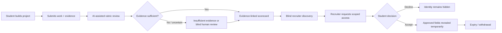

# AptoHire — End-to-end product journey

## The journey judges should see

## Product contract by stage

| Stage | Student value | Recruiter/institution value | Trust condition |
|---|---|---|---|
| Project submission | One place to present work | More than résumé claims | Student controls submission and evidence |
| AI-assisted assessment | Structured feedback and skill gaps | Comparable, reviewable signals | Evidence references, schema checks and uncertainty handling |
| Scorecard | Portable explanation of demonstrated skills | Inspectable capability | Human review for borderline or disputed outcomes |
| Blind discovery | Less premature identity exposure | Relevant candidates with match reasons | Identity excluded from initial candidate projection |
| Access request | Explicit choice | Clear next step | Scope, purpose and duration shown to student |
| Reveal | Student-approved sharing | Access to approved details | Least privilege, expiry and withdrawal |
| University insights | Better learning feedback | Cohort-level readiness view | Role-scoped, aggregate data; no unauthorized identity leakage |

## Failure states are part of the product
A trustworthy journey must also handle a provider timeout, unreadable evidence, insufficient proof, a low-confidence result, a declined access request, an expired grant, a withdrawn grant and an unauthorized recruiter. The interface should show a safe, understandable state and never silently convert a failure into a positive score or access grant.

## Demo rule
Run the complete journey with fictional data in the environment that will be shown to judges. Clearly identify any mocked step. A diagram, code file or saved screenshot is not proof that the deployed flow succeeded.
