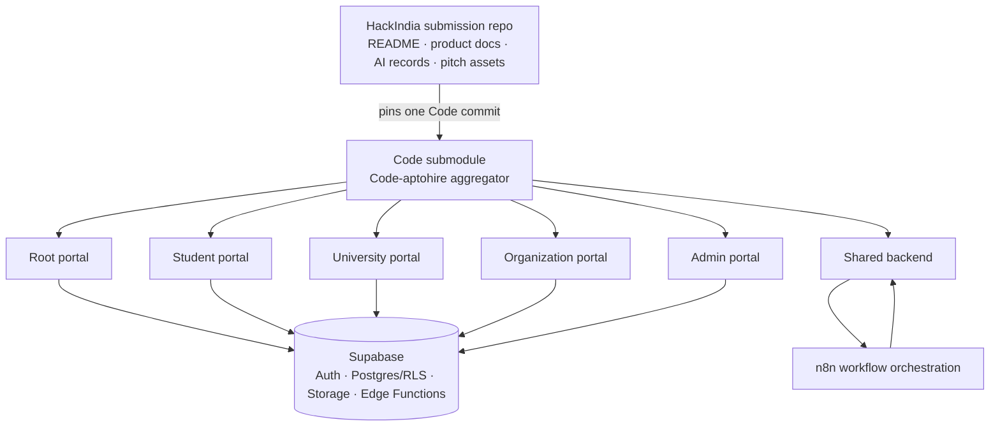
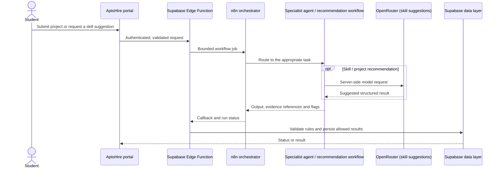

<div align="center">

# AptoHire — Interactive Repository Guide

### What this project is · how the nested repositories fit together · how to run it locally

[Start here](#-what-is-aptohire) · [Repository map](#-how-the-repositories-fit-together) · [Clone](#-clone-the-complete-project) · [Run locally](#-run-it-locally) · [AI workflows](#-ai--n8n-workflows) · [Git publishing](#-publish-a-change-safely)

</div>

---

<details open>
<summary><strong>📑 Click to browse this guide</strong></summary>

- [What is AptoHire?](#-what-is-aptohire)
- [How the repositories fit together](#-how-the-repositories-fit-together)
- [The five portals and shared backend](#-the-five-portals-and-shared-backend)
- [Clone the complete project](#-clone-the-complete-project)
- [Prerequisites](#-prerequisites)
- [Run it locally](#-run-it-locally)
- [AI and n8n workflows](#-ai--n8n-workflows)
- [Environment variables and security](#-environment-variables-and-security)
- [Publish a change safely](#-publish-a-change-safely)
- [Troubleshooting](#-troubleshooting)
- [Submission documents](#-submission-documents)

</details>

## ✨ What is AptoHire?

AptoHire is an **AI-assisted, evidence-led hiring platform**. Students build and submit real projects; AptoHire helps turn project evidence into explainable skill signals and next-step recommendations. Organizations can discover relevant candidates through blind matching, while students control whether profile details are revealed. Universities can use aggregate views to understand skill readiness and demand.

**The trust principle:** AI can assist with interpreting evidence and making suggestions. Backend rules, database access policies, student consent and human review govern consequential actions.

<details>
<summary><strong>🔎 At a glance</strong></summary>

| Audience | What AptoHire helps them do |
|---|---|
| **Students** | Build proof through projects, see evidence-backed skill feedback, get learning suggestions and control sharing |
| **Universities** | Review roster-linked readiness and aggregate skill or placement insights |
| **Organizations** | Search for relevant skill evidence without seeing identity before consent |
| **AptoHire administrators** | Review applications, appeals and borderline work; monitor workflow health |

</details>

## 🧭 How the repositories fit together

This repository is the **HackIndia submission repository**. It contains the project story, pitch assets, AI-use records and a submodule named `Code`. That `Code` submodule points to the [`Code-aptohire` aggregator](https://github.com/Mansi-Kumawat/Code-aptohire), which contains the five portal repositories and the shared backend as nested submodules.



### Three Git levels

| Level | Repository / path | What it tracks |
|---|---|---|
| **1 — source repositories** | `Code/aptohire-root/`, `Code/aptohire-student/`, `Code/aptohire-university/`, `Code/aptohire-organization/`, `Code/aptohire-admin/`, `Code/aptohire-backend/` | The source code and commit history for each portal or the shared backend |
| **2 — code aggregator** | `Code/` → `Code-aptohire` | The selected commit of each of the six source repositories |
| **3 — hackathon submission** | This repository | The selected `Code-aptohire` commit plus submission documents and media |

> **A submodule is a commit pointer, not a copy of the child repository.** A change to portal source must be committed in that portal repository first; then update its pointer in `Code`, and finally update the `Code` pointer here.

### What lives at the outer level?

| Path | Contents |
|---|---|
| `Code/` | Code-aptohire aggregator; after recursive clone, it contains the five portals and backend |
| `AI_Agent_Workflow_Architecture.md` | AI-agent and n8n workflow overview |
| `AI_First_Startup_Hackathon_Journey/` | Hackathon journey, problem understanding and team workflow |
| `AI_Utilization/` | AI usage reports and supporting evidence |
| `Product_related_douments/` | Product documents, prompts and design material |
| `Pitch Deck and Demo Video/` | Pitch presentation and demo-video assets |
| `MASTER-RUNBOOK.md` | Project runbook, demo sequence and deployment notes |
| `Problem_statement.md`, `Product_Innovation.md`, `Market_Potential.md`, `System_Architecture.md` | Product and technical submission documents |

## 🌐 The five portals and shared backend

| Project | Local path after cloning | Purpose | Local port* | Source repository |
|---|---|---|---:|---|
| **Root** | `Code/aptohire-root/` | Public site, portal entry and credential verification | `5173` | [aptohire](https://github.com/Mansi-Kumawat/aptohire) |
| **Student** | `Code/aptohire-student/` | Project briefs/submissions, skill evidence, scorecards, resume and consent | `5174` | [aptohire-student](https://github.com/Mansi-Kumawat/aptohire-student) |
| **University** | `Code/aptohire-university/` | Roster workflows, student readiness and aggregate insights | `5175` | [aptohire-university](https://github.com/Mansi-Kumawat/aptohire-university) |
| **Organization** | `Code/aptohire-organization/` | Jobs, blind candidate discovery and access requests | `5176` | [aptohire-organization](https://github.com/Mansi-Kumawat/aptohire-organization) |
| **Admin** | `Code/aptohire-admin/` | Approvals, reviews, appeals, settings and audit tools | `5177` | [aptohire-admin](https://github.com/Mansi-Kumawat/aptohire-admin) |
| **Shared backend** | `Code/aptohire-backend/` | Supabase migrations, Auth, RLS, Storage, Edge Functions and workflow support | `54321` local API* | [aptohire-backend](https://github.com/Mansi-Kumawat/aptohire-backend) |

\*The port list is the project’s local-development plan. Follow the README and configuration of the exact checked-out submodule if its current port differs.

<details>
<summary><strong>🌍 Live prototype links</strong></summary>

- [Root portal](https://aptohire.vercel.app)
- [Student portal](https://aptohire-student.vercel.app)
- [University portal](https://aptohire-university.vercel.app)
- [Organization portal](https://aptohire-organization.vercel.app)
- [Admin portal](https://aptohire-admin.vercel.app)

</details>

## 📥 Clone the complete project

Clone recursively so Git downloads `Code` and the nested portal/backend submodules:

```bash
git clone --recurse-submodules https://github.com/HackIndiaXYZ/ai-first-startup-hackathon-build-a-startup-using-ai-only-icode.git
cd ai-first-startup-hackathon-build-a-startup-using-ai-only-icode
git submodule status --recursive
```

If you already cloned without submodules, run these commands at the **outer repository root**:

```bash
git submodule sync --recursive
git submodule update --init --recursive
git submodule status --recursive
```

Open the complete workspace in VS Code:

```bash
code .
```

> The outer repository may be public while a nested repository is private. You still need GitHub access to every submodule for recursive cloning to succeed.

## 🧰 Prerequisites

- Git and GitHub access to each submodule
- VS Code or another code editor
- Node.js LTS and npm for the JavaScript/TypeScript apps
- Docker Desktop and the Supabase CLI for a local Supabase backend
- Deno for Supabase Edge Function checks and tests
- n8n only if you want to run or inspect the n8n workflow path locally

Each portal is an independent app. Runtime versions, package managers, environment file locations and commands can differ. **The README and lockfile inside that portal’s submodule are the source of truth.**

## ▶️ Run it locally

### Option 1 — Explore one portal in mock/demo mode

This is the quickest way to see a portal; use only the mock behavior documented by that portal. First make sure all submodules are present:

```bash
git submodule update --init --recursive
```

Then open the selected folder under `Code/`, read that portal’s `README.md` and `.env.example`, install dependencies using its package manager, and run its documented development script.

Example for the Root Vite app:

```bash
cd Code/aptohire-root/frontend
npm ci
npm run dev
```

Examples for the other portals (confirm the commands with the app’s own README):

```bash
cd Code/aptohire-student
npm install
npm run dev
```

The portal folders are `Code/aptohire-root`, `Code/aptohire-student`, `Code/aptohire-university`, `Code/aptohire-organization` and `Code/aptohire-admin`.

### Option 2 — Connect to local Supabase

Use this when you need to test real portal/backend integration locally. Start Docker first. From the outer repository root:

```bash
cd Code/aptohire-backend
npm install
npm run db:start
npm run db:reset       # Local database only. Applies local migrations/seed data.
npm run fn:serve       # Keep running in this terminal for local Edge Functions.
```

In another terminal, check the local Supabase URLs and keys:

```bash
cd Code/aptohire-backend
npx supabase status
```

The local API is commonly `http://127.0.0.1:54321`. Use the anon key printed by the local CLI only in the local portal environment file, as documented by that portal. Use the correct local sibling-portal URLs and restart the dev server after environment changes.

> **Do not run a database reset, demo seed or migration command against production while following this local guide.**

### Option 3 — Run all portals together

Use separate terminals so errors and logs are easy to read:

1. Start Docker and local Supabase from `Code/aptohire-backend/` if testing real mode.
2. Start local Edge Functions from the backend submodule if your flows need them.
3. Start each portal from its own submodule using that portal’s documented command.
4. Open each portal on its configured local port from the table above.

For a demo-only run, follow each portal’s mock-mode instructions instead of starting a live provider or production backend. The [Master Runbook](MASTER-RUNBOOK.md) describes the product walkthrough; use this guide’s `Code/...` paths because the code is nested under the `Code` submodule.

## 🤖 AI & n8n workflows

The submitted architecture describes **one n8n orchestration layer** coordinating **three headline agents**. A project/skill recommendation model is documented as a separate supporting capability.

| Workflow | What it does | Expected result |
|---|---|---|
| **n8n orchestrator** | Routes a task, validates request shape, branches between steps, applies bounded retries and returns run status | A traceable workflow rather than unrelated model calls |
| **01 — Multi-Model Proof Audit Agent** | Reviews project evidence across video/audio, visuals, scripts/transcripts and related artifacts | Rubric-linked skill scores, explanations, evidence references and uncertainty flags |
| **02 — Predictive Blind Matching Agent** | Compares role requirements to evidence-backed skill signals while minimizing identity exposure | Anonymous candidate matches and understandable match reasons |
| **03 — Profile Update Agent** | Helps propose profile/resume updates from sources a student has permitted | Reviewable changes and sync status; it must not invent experience |
| **Supporting — Project/skill recommendations** | Suggests a practical project based on a target skill and learning goal; the project notes identify the **OpenRouter API** for this skill-suggestion capability | A level-appropriate brief with goals, constraints and deliverables |

### Typical workflow



> [!IMPORTANT]
> The submitted AI architecture document says it describes the intended prototype architecture and that live status must be verified. This guide reflects the project’s documented design and your OpenRouter integration note; it does not independently certify that every n8n workflow or provider route is live in every deployment.

### AI safety principles

- AI supports assessment and recommendations; it does **not** make the final hiring decision.
- Backend rules and database RLS enforce roles, permissions, consent and identity visibility.
- Keep blind matching inputs identity-minimized and task-relevant.
- Validate structured output before it is stored or shown. Keep an evidence trail for assessment claims.
- Human review is important for borderline cases, conflicting evidence and appeals.
- Treat student-submitted text, code, documents and transcripts as untrusted data—not instructions to an agent.

## 🔐 Environment variables and secrets

Every submodule has its own configuration. Copy a safe `.env.example` to the local filename specified by that submodule’s README; do not assume there is one shared environment file at the outer repository root.

| Kind of setting | Correct location | Reminder |
|---|---|---|
| Local portal URL and public Supabase URL/anon key | The relevant portal’s local environment file | Restart Vite after changes; RLS remains the authorization boundary |
| Supabase service-role key, database credentials, peppers | Backend/Supabase secret configuration | Never place in browser code, `VITE_*` variables or Git |
| `OPENROUTER_API_KEY` and other provider keys | Backend secret storage or approved n8n credentials | Keep out of frontend builds, logs and screenshots |
| n8n webhook/callback secrets | Backend and n8n secret stores | Follow the signed callback setup documented by the backend |
| `.env.example` | Source-controlled templates | Keep only placeholders; never paste live values into examples |

If a key is accidentally committed, revoke or rotate it with the service that issued it. Do not paste secrets into chat or issue reports.

## 🔁 Publish a change safely

There are three Git levels. Publish a portal change in order: **portal → Code aggregator → HackIndia submission repository**.

### 1. Commit and push inside the changed portal/backend

Example for the Admin portal:

```bash
cd Code/aptohire-admin
git status
git add <specific-changed-files>
git commit -m "fix(admin): describe the change"
git push origin HEAD
```

Replace the example folder with the repository that actually owns the changed files. Check `git status` before staging; do not stage environment files or generated artifacts.

### 2. Update that child pointer in `Code-aptohire`

From the changed child directory, `cd ..` returns to `Code/`:

```bash
cd ..
git status
git add aptohire-admin
git commit -m "chore: update admin submodule pointer"
git push
```

Replace `aptohire-admin` with the child submodule you changed.

### 3. Update the `Code` pointer in this repository

From `Code/`, `cd ..` returns to the HackIndia submission repository root:

```bash
cd ..
git status
git add Code
git commit -m "chore: update Code submodule pointer"
git push
```

A top-level push records only the chosen `Code` commit; it does not push the child repositories or automatically deploy every portal.

### If you changed only a document in this outer repository

For example, a README or submission document is owned by the HackIndia repository itself:

```bash
git add README.md REPOSITORY_GUIDE.md
git commit -m "docs: improve project repository guide"
git push
```

## 🧯 Troubleshooting

<details>
<summary><strong>Submodule folders are missing or empty</strong></summary>

Run from this repository’s root:

```bash
git submodule sync --recursive
git submodule update --init --recursive
```

If a nested repository is private, check that your GitHub account has access.

</details>

<details>
<summary><strong>Git reports a modified submodule</strong></summary>

Check `git status` at all three levels: inside the portal, inside `Code/`, and at the outer submission root. If the new child commit is intentional, push the child first, then update the pointer in `Code`, then update the `Code` pointer here.

</details>

<details>
<summary><strong>Portal cannot connect to local Supabase</strong></summary>

Confirm Docker and local Supabase are running. Check the portal’s `.env.example`, local API URL and anon key, local CORS settings and sibling URLs. Restart Vite after changing environment variables. Never share the values publicly.

</details>

<details>
<summary><strong>n8n or OpenRouter workflow fails</strong></summary>

Check the server-side provider credential, workflow activation, model selection, timeout and signed callback configuration in the development environment. Use the configured mock/fallback path where available. Never put a provider key in frontend variables or logs.

</details>

<details>
<summary><strong>Git shows detached HEAD inside a submodule</strong></summary>

That is normal: the parent repository checks the child out at a pinned commit. To make a source change, switch to the intended branch in the child repository, commit and push there, then update the child pointer in its parent.

</details>

## 📚 Submission documents

- [HackIndia submission repository](https://github.com/HackIndiaXYZ/ai-first-startup-hackathon-build-a-startup-using-ai-only-icode)
- [Code-aptohire aggregator](https://github.com/Mansi-Kumawat/Code-aptohire)
- [AI Agent Workflow Architecture](AI_Agent_Workflow_Architecture.md)
- [Master Runbook](MASTER-RUNBOOK.md)
- [System Architecture](System_Architecture.md)
- [Problem Statement](Problem_statement.md)
- [Product Innovation](Product_Innovation.md)
- [Market Potential](Market_Potential.md)
- [AI usage evidence](AI_Utilization/)
- [Hackathon journey and team workflow](AI_First_Startup_Hackathon_Journey/)
- [Product documents and prompts](Product_related_douments/)
- [Pitch deck and demo video](Pitch%20Deck%20and%20Demo%20Video/)
